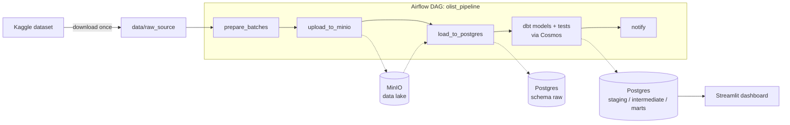

# Olist ELT Stack

End-to-end batch data pipeline on the [Olist Brazilian E-commerce dataset](https://www.kaggle.com/datasets/olistbr/brazilian-ecommerce).
Raw files land in a data lake, are loaded into a warehouse, modelled into a star schema with dbt, orchestrated by Airflow and served through a Streamlit dashboard.

The source data is a static export, so it is **simulated as daily batches** (2018-08-01 to 2018-08-07).

## Architecture



| Layer | Where | What |
|---|---|---|
| Raw files | MinIO bucket, Hive-style partitions `batch_date=YYYY-MM-DD/` | CSV batches as produced by `prepare_batches.py` |
| `raw` | Postgres | Tables loaded as-is from MinIO |
| `staging` | dbt views | 9 models: renaming, typing, cleaning |
| `intermediate` | dbt views | 3 models: one row per order (items, payments, reviews) |
| `marts` | dbt tables | Star schema: `fct_orders`, `fct_order_items`, `dim_customers`, `dim_products`, `dim_sellers` |

## Stack

| Tool | Role |
|---|---|
| Docker Compose | Runs every service locally |
| MinIO | S3-compatible data lake |
| Postgres 16 | Data warehouse (and Airflow metadata, in a separate database) |
| dbt-core + dbt-postgres | Transformations and 44 data tests |
| Airflow 2.11 + Astronomer Cosmos | Orchestration; Cosmos turns each dbt model into an Airflow task |
| Streamlit | Dashboard on the marts |
| GitHub Actions | CI: ruff, `dbt parse`, compose validation |

Design choices worth knowing:
- **dbt runs in its own virtualenv** inside the Airflow image, so its dependencies cannot clash with Airflow's.
- **Data quality gate:** Cosmos runs each model's tests right after the model; a failing test stops everything downstream.
- **Idempotent load:** `load_to_postgres.py` truncates and reloads, so the DAG can be re-run safely (a `DROP TABLE` would fail because dbt views depend on `raw`).
- **One Postgres server, two databases** (`dwh` and `airflow`) to keep memory low; the stack is sized for 4 GB of Docker RAM.

## Run it

Requirements: Docker Desktop (4 GB RAM or more), Python 3.12, a free [Kaggle](https://www.kaggle.com) account with an API token in `~/.kaggle/access_token`.

```bash
# 1. Configuration
cp .env.example .env          # then set your own passwords

# 2. Download the dataset once (outside the DAG)
python3 -m venv .venv && source .venv/bin/activate
pip install -r requirements.txt
python ingestion/download_dataset.py

# 3. Start everything (Postgres, MinIO, Airflow, Streamlit)
make up
```

| Service | URL |
|---|---|
| Airflow | http://localhost:8080 (user and password from `.env`) |
| Streamlit | http://localhost:8501 |
| MinIO console | http://localhost:9001 |

Open Airflow, unpause `olist_pipeline` and trigger it. The first run takes about two minutes. Then open the dashboard.

Other commands: `make down`, `make logs`, `make ps`, `make psql`. `make clean` also **deletes the data volumes**.

To run dbt from your own terminal, add a profile named `dbt_project` to `~/.dbt/profiles.yml` (host `localhost`, schema `analytics`, credentials from `.env`), then:

```bash
cd dbt_project
dbt build            # models + tests
dbt docs generate && dbt docs serve
```

Use the `dbt` installed in `.venv`: a different binary in your PATH may be dbt Fusion 2.x, which does not support Postgres.

## Screenshots


## Repository layout

```
dags/            Airflow DAG
ingestion/       batch preparation, MinIO upload, Postgres load (shared config in config.py)
dbt_project/     staging, intermediate and marts models with tests
streamlit_app/   dashboard
docker/airflow/  custom Airflow image (Cosmos + dbt)
scripts/         Postgres init SQL
.github/         CI workflow
```

## Limitations

- The data covers only seven days, so time-series charts are short.
- CI validates the project (lint, `dbt parse`, compose) but does not run the pipeline end to end; data quality is covered by the dbt tests that run inside the DAG.
- Postgres and MinIO ports are published on all interfaces and credentials are local-development grade: not production-ready.
- The DAG was run with `airflow dags test`; scheduled runs (`@daily`) were not observed over time.
