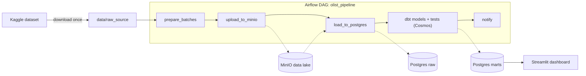

# Olist ELT Stack

End-to-end batch data pipeline on the [Olist Brazilian E-commerce dataset](https://www.kaggle.com/datasets/olistbr/brazilian-ecommerce).
Raw files land in a data lake, are loaded into a warehouse, modelled into a star schema with dbt, orchestrated by Airflow and served through a Streamlit dashboard.
The source is a static export, so it is **simulated as daily batches** (2018-08-01 to 2018-08-07).

## Architecture



| Layer | Where | Content |
|---|---|---|
| Files | MinIO, partitions `batch_date=YYYY-MM-DD/` | CSV batches |
| `raw` | Postgres | Tables loaded as-is from MinIO |
| `staging` | dbt views | 9 models: renaming, typing, cleaning |
| `intermediate` | dbt views | 3 models: one row per order |
| `marts` | dbt tables | Star schema: `fct_orders`, `fct_order_items`, `dim_customers`, `dim_products`, `dim_sellers` |

## Stack

Docker Compose · MinIO · Postgres 16 · dbt-core (44 tests) · Airflow 2.11 + Astronomer Cosmos · Streamlit · GitHub Actions (ruff, `dbt parse`, compose check)

Design choices:
- **Cosmos** turns each dbt model into an Airflow task and runs its tests right after it: a failing test stops everything downstream.
- **dbt runs in its own virtualenv** inside the Airflow image, so its dependencies cannot clash with Airflow's.
- **The load is idempotent** (truncate and reload), so the DAG can be re-run safely.
- **One Postgres server, two databases** (`dwh` and `airflow`); the stack fits in 4 GB of Docker RAM.

## Run it

Requirements: Docker Desktop (4 GB RAM or more), Python 3.12, a free Kaggle account with an API token in `~/.kaggle/access_token`.

```bash
cp .env.example .env                  # set your own passwords
python3 -m venv .venv && source .venv/bin/activate
pip install -r requirements.txt
python ingestion/download_dataset.py  # once, outside the DAG
make up                               # Postgres, MinIO, Airflow, Streamlit
```

- Airflow: http://localhost:8080 (credentials in `.env`). Unpause and trigger `olist_pipeline`; a run takes about two minutes.
- Dashboard: http://localhost:8501
- Other commands: `make down`, `make logs`, `make ps`, `make psql`. `make clean` also deletes the data volumes.

To run dbt from your terminal, create a profile named `dbt_project` in `~/.dbt/profiles.yml` (host `localhost`, schema `analytics`), then `cd dbt_project && dbt build`. Use the `dbt` from `.venv`: another binary in your PATH may be dbt Fusion, which does not support Postgres.

## Limitations

- Only seven days of data, so time series are short.
- CI does not run the pipeline end to end; data quality is covered by the dbt tests inside the DAG.
- Local-development setup: credentials and exposed ports are not production-grade.
- The DAG was tested with `airflow dags test`; scheduled `@daily` runs were not observed over time.
